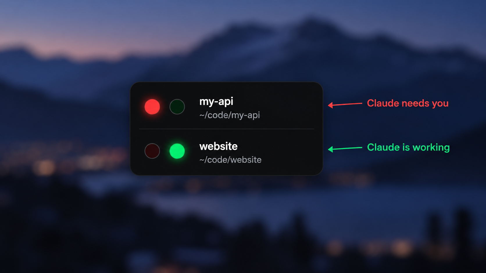
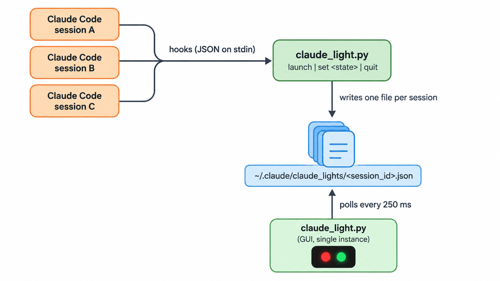

# Claude Light

A small always-on-top "traffic light" that shows the state of every running
[Claude Code](https://claude.com/claude-code) session at a glance, so you know
when Claude is working and when it is waiting for you.



- **Green**: Claude is working (you sent a prompt, or a tool just ran).
- **Blinking red**: Claude is waiting for you (it finished its turn, needs a
  permission, asks a question, or wants you to approve a plan).
- **One row per session**, labelled with the folder the session runs in. If two
  sessions run in the same folder they show as `name`, `name (2)`, and so on.

It is a single Python file with no dependencies beyond the standard library
(`tkinter`), and it plugs into Claude Code through
[hooks](https://docs.claude.com/en/docs/claude-code/hooks).

## Requirements

- Python 3.8+ with **tkinter**
  - macOS (Homebrew): `brew install python-tk`
  - Debian/Ubuntu: `sudo apt install python3-tk`
  - Windows / python.org installers: tkinter is included
- Claude Code

Check that tkinter works:

```sh
python3 -c "import tkinter; tkinter.Tk().destroy(); print('ok')"
```

## Installation

### Option A: as a plugin (recommended)

In Claude Code, add this repository as a plugin marketplace and install the
plugin:

```
/plugin marketplace add IndominusPsych/session-claude-light
/plugin install session-claude-light@session-claude-light
```

Then start a new session. The plugin registers all
the hooks for you, so you don't edit any settings. To update later, run
`/plugin marketplace update session-claude-light`.

The plugin's hooks run `python3`, so `python3` on your `PATH` must have
tkinter. If it doesn't, use Option B and point the hooks at a Python that does.

### Option B: manual install

Use this if you want to change the hook commands or edit the script.

1. **Copy the script** into your Claude config folder:

   ```sh
   git clone https://github.com/IndominusPsych/session-claude-light.git
   cp session-claude-light/claude_light.py ~/.claude/claude_light.py
   ```

2. **Add the hooks** to your Claude Code settings. Merge the `hooks` block from
   [`settings.example.json`](settings.example.json) into one of:

   | File | Scope |
   | --- | --- |
   | `~/.claude/settings.json` | All your projects (recommended) |
   | `<project>/.claude/settings.json` | One project, shared with the repo |
   | `<project>/.claude/settings.local.json` | One project, just for you |

   If you already have hooks for an event, add the Claude Light entry to that
   event's list rather than replacing it.

3. **Start a new Claude Code session.** The light appears in the top-left
   corner of your screen.

Use only one option. If you have both the plugin and the manual hooks, every
event runs twice. Nothing breaks, but it's wasted work.

### Choosing the Python interpreter (manual install)

The example uses `python3` from your `PATH`. If that Python has no tkinter (or
hooks run with a different `PATH` than your shell), use an absolute path to an
interpreter that does, for example:

```json
"command": "/opt/homebrew/bin/python3 ~/.claude/claude_light.py set running"
```

On Windows, use the full paths, for example:

```json
"command": "py C:\\Users\\you\\.claude\\claude_light.py set running"
```

## Configuration

### Hooks

Each hook calls the script with one command:

| Command | Effect |
| --- | --- |
| `launch` | Registers the session (red) and opens the window if it is closed |
| `set running` | Turns the session's row green |
| `set waiting` | Turns the session's row blinking red |
| `quit` | Removes the session's row |

The plugin ([`hooks/hooks.json`](hooks/hooks.json)) and the manual example
([`settings.example.json`](settings.example.json)) wire them up the same way:

| Hook event | Matcher | Command | Why |
| --- | --- | --- | --- |
| `SessionStart` | | `launch` | New session appears |
| `UserPromptSubmit` | | `set running` | You sent a prompt |
| `PostToolUse` | `*` | `set running` | Back to work after a tool (or after you approved one) |
| `PreToolUse` | `AskUserQuestion\|ExitPlanMode` | `set waiting` | Claude asks you a question or wants a plan approved |
| `PermissionRequest` | `*` | `set waiting` | Claude needs permission to run a tool |
| `Notification` | | `set waiting` | Claude Code is notifying you (e.g. idle input) |
| `Stop` | | `set waiting` | Claude finished its turn |
| `SessionEnd` | | `quit` | Session closed |

With the manual install you can drop or change any of these. For example,
remove the `PreToolUse` entry if you don't want questions to count as
"waiting". With the plugin, fork the repo and edit `hooks/hooks.json`. Don't
edit the installed copy in the plugin cache, because updates overwrite it.

### Tweaking the script

The constants at the top of `claude_light.py` control its behaviour (manual
install, or your own fork of the plugin):

| Constant | Default | Meaning |
| --- | --- | --- |
| `COLORS` | green `#22c55e`, red `#ef4444` | Lit colours for running / waiting |
| `DIM_RED`, `DIM_GREEN`, `PULSE_RED` | dark shades | Unlit colours and the blink colour |
| `POLL_MS` | `250` | How often the window refreshes (also the blink rate) |
| `EXIT_AFTER_EMPTY_S` | `3` | Close the window this many seconds after the last session ends |
| `STARTUP_GRACE_S` | `5` | Don't auto-close during the first seconds after opening |
| `LOCK_PORT` | `47821` | Local port used to keep only one window open |
| `BASE` | `~/.claude` | Where state and logs are kept |

Window size, fonts and colours are set at the start of `run_gui()`.

## Using the window

- **Drag** anywhere on the window to move it.
- **Right-click** (or Ctrl-click, or middle-click) a row to dismiss it.
- The window **closes on its own** a few seconds after the last session ends,
  and reopens with the next hook.
- Run `python3 ~/.claude/claude_light.py` to open it by hand, or
  `python3 ~/.claude/claude_light.py plain` to open it as a normal titled
  window (useful for debugging).

## How it works



The script has two halves.

**Hook side.** Claude Code runs the script on each hook and pipes in JSON
that includes the `session_id` and `cwd`. The script writes
`~/.claude/claude_lights/<session_id>.json` with the session's state, folder,
start time and the process ID of the Claude Code process (found by walking up
the parent processes past any shells). Files are written atomically
(write to a temp file, then rename) so the window never reads a half-written
file. After writing, it checks whether the window is open and starts it in the
background if not. The hook returns straight away and does not slow Claude
Code down.

**GUI side.** A borderless, always-on-top `tkinter` window that never takes
focus from your terminal. It holds a socket on `127.0.0.1:47821` so only one
window ever runs. Every 250 ms it reads all session files, sorts them by start
time and draws one row per session.

**Cleaning up dead sessions.** If a terminal is closed without a clean
`SessionEnd`, the window notices that the recorded Claude Code process is
gone and removes its row. (On Windows the process ID isn't recorded, so rows
there are removed by `SessionEnd` or by right-click.)

## Files it creates

| Path | Purpose |
| --- | --- |
| `~/.claude/claude_lights/*.json` | One state file per session |
| `~/.claude/claude_light.log` | Output and errors from the window process |

To uninstall:

- **Plugin:** run `/plugin uninstall session-claude-light@session-claude-light` (and
  `/plugin marketplace remove session-claude-light` if you like).
- **Manual:** remove the hooks from your settings and delete
  `~/.claude/claude_light.py`.

Then delete `~/.claude/claude_lights/` and `~/.claude/claude_light.log`.

## Repository layout

| Path | Purpose |
| --- | --- |
| `claude_light.py` | The whole program: hook handler and window |
| `.claude-plugin/plugin.json` | Plugin manifest |
| `.claude-plugin/marketplace.json` | Lets this repo act as its own plugin marketplace |
| `hooks/hooks.json` | Hooks the plugin registers (uses `${CLAUDE_PLUGIN_ROOT}`) |
| `settings.example.json` | The same hooks, for a manual install |

## Troubleshooting

- **The window never appears.** Check `~/.claude/claude_light.log`. The most
  common cause is a Python without tkinter; point the hook commands at an
  interpreter that has it (see above).
- **"Light already running (port 47821 in use)".** Another window is open, or
  another program uses that port. Change `LOCK_PORT` in the script.
- **A row is stuck.** Right-click it to dismiss it, or delete its file in
  `~/.claude/claude_lights/`.
- **Hooks don't fire.** Run `/hooks` in Claude Code to see which hooks are
  loaded. For the plugin, check that it's enabled in `/plugin`. For a manual
  install, check that your settings file is valid JSON.

## Platform support

Developed and tested on macOS. Linux should work wherever tkinter does
(the window is drawn without decorations). Windows works, with the dead-session
limitation noted above.

## License

[MIT](LICENSE)
